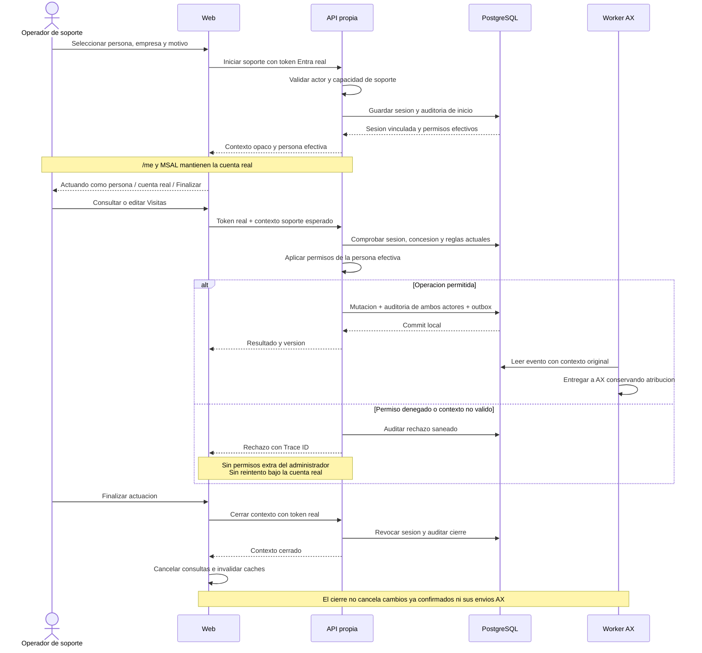

# Visitas: actuar como otra persona con identidad trazable

Estado: diseño propuesto, no implementado. Decisión confirmada: lectura y edición con los permisos de la persona seleccionada desde que se activa el contexto. Fuente: [diseño de soporte](../../../integration/visitas-autonomas.md#72-actuar-como-otra-persona-para-soporte).

Exportaciones: [SVG](../../../assets/technical/auth/visits-support-context-sequence.svg) · [PNG](../../../assets/technical/auth/visits-support-context-sequence.png).

El token Entra autentica siempre al actor real. El contexto efectivo es local, revocable y propio de la pestaña. Toda ruta administrativa se evalúa como actor real fuera de la actuación. La sesión y las concesiones se comprueban por petición y al autorizar una mutación; lectura y escritura siguen los permisos de la persona representada. La confirmación de entrega AX se produce con el contrato asíncrono descrito en el diseño general.
