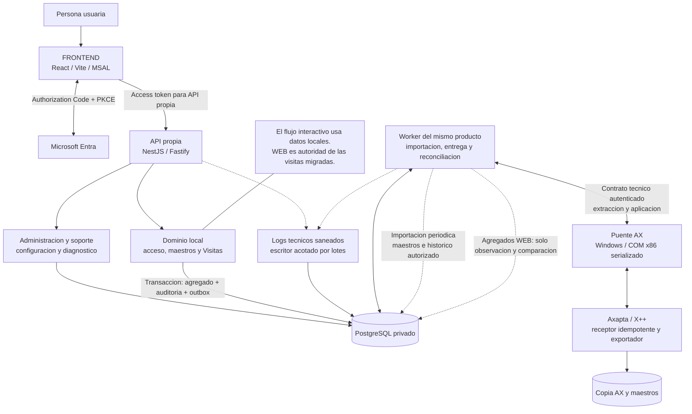

# Visitas: arquitectura autónoma propuesta

Estado: propuesta, todavía sin implementar. Decisión confirmada: las visitas migradas se editan solo en la nueva web. Véase el [análisis y las fases](../../../integration/visitas-autonomas.md).

Exportaciones: [SVG](../../../assets/technical/integration/visits-autonomous-target.svg) · [PNG](../../../assets/technical/integration/visits-autonomous-target.png).

El worker y el receptor AX son capacidades nuevas. La semilla estándar no implementa sincronización. Un proceso técnico utiliza su propia identidad; el guard delegado de usuarios no se reutiliza como autenticación de jobs. La caída de AX mantiene pendientes los trabajos y permite continuar con datos locales.
