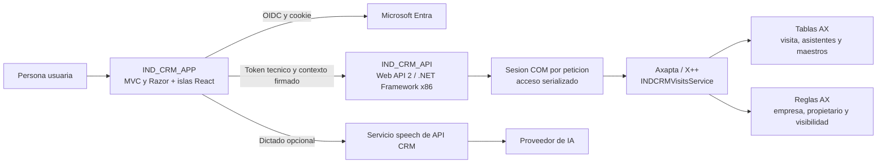

# Visitas: arquitectura actual

Estado: comportamiento comprobado en las fuentes indicadas por el [análisis de separación](../../../integration/visitas-autonomas.md). La disponibilidad real de AOT y entornos queda pendiente de validar.

Exportaciones: [SVG](../../../assets/technical/integration/visits-current-flow.svg) · [PNG](../../../assets/technical/integration/visits-current-flow.png).

El inicio Entra no elimina la dependencia AX: el contexto funcional, los maestros, las consultas y las escrituras pasan por API/AX. Alta de cabecera y altas de asistentes son operaciones separadas. La cuenta técnica y el propietario funcional son identidades distintas.
