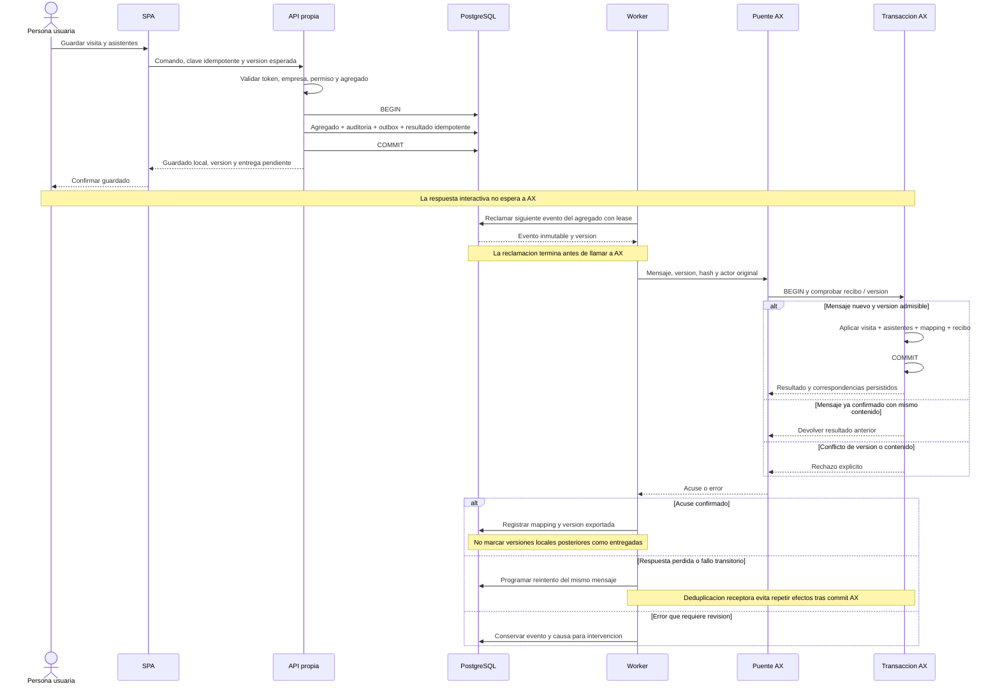

# Visitas: guardado local y entrega asíncrona

Estado: diseño propuesto, no contrato AX disponible. Los nombres de comandos y almacenamiento receptor son conceptuales. Véase el [diseño de sincronización](../../../integration/visitas-autonomas.md).

Exportaciones: [SVG](../../../assets/technical/integration/visits-outbox-sequence.svg) · [PNG](../../../assets/technical/integration/visits-outbox-sequence.png).

La deduplicación receptora y los cambios AX deben confirmar en la misma transacción. El outbox local no ofrece por sí solo esa garantía. Ordenar por agregado, conservar tombstones y retener recibos durante toda la ventana de reenvío/recuperación. Los errores previos al commit local no generan entrega.
