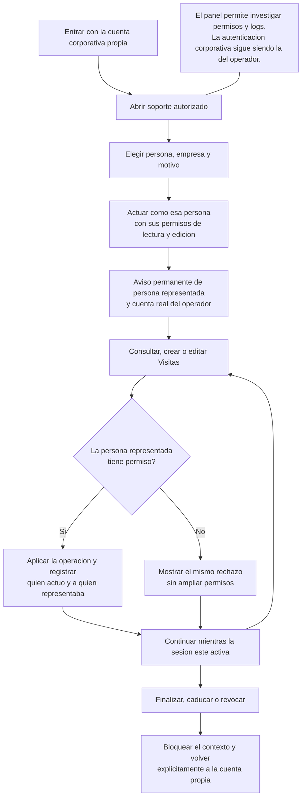

# Visitas: soporte desde el contexto de otra persona

Estado: funcionamiento propuesto. La persona autorizada de soporte puede consultar y editar con los mismos permisos de la persona seleccionada. Fuente técnica: [actuación trazable](../../technical/auth/visits-support-context-sequence.md).

Exportaciones: [SVG](../../../assets/user/auth/visits-support-context.svg) · [PNG](../../../assets/user/auth/visits-support-context.png).

El operador no necesita la contraseña de la persona representada. El sistema conserva quién realizó realmente cada cambio. Este modo reproduce las reglas y datos de Visitas; los fallos del inicio corporativo o del navegador de la otra persona pueden necesitar diagnóstico adicional. Los cambios confirmados mantienen su auditoría y su envío pendiente a Axapta después de cerrar soporte.
