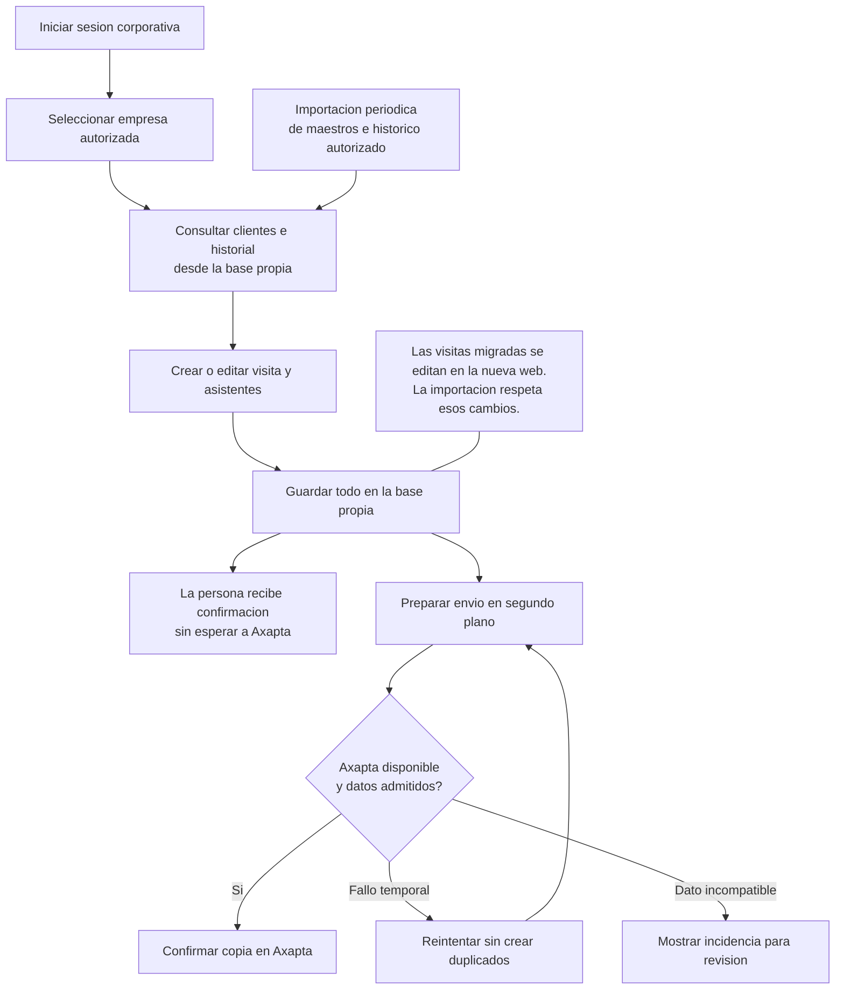

# Visitas: trabajo autónomo y copia en Axapta

Estado: funcionamiento propuesto. Axapta es el sistema central de gestión que recibirá una copia de las visitas. Fuente técnica: [arquitectura destino](../../technical/integration/visits-autonomous-target.md) y [guardado y entrega](../../technical/integration/visits-outbox-sequence.md).

Exportaciones: [SVG](../../../assets/user/integration/visits-autonomous-workflow.svg) · [PNG](../../../assets/user/integration/visits-autonomous-workflow.png).

El estado de envío se mostrará por separado del guardado y del estado de negocio. Una incidencia en Axapta no debe hacer perder la visita guardada. Las modificaciones inesperadas en la copia Axapta requieren revisión. La frecuencia de actualización y el retraso aceptable siguen pendientes de acordar.
